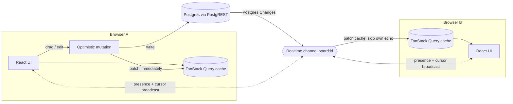

# LiveBoard

[](https://github.com/praveen-raj-r/live-board/actions/workflows/ci.yml)
[](LICENSE)

A real-time collaborative Kanban board. Open the site, get a board, share its link, and everyone who opens it edits the same board live. No accounts, no sign-up, no settings.

**[Try the live demo →](https://live-kanban-board.vercel.app/)**

## What you can do

- **Share by link.** Visiting the site creates a new board (To Do, In Progress, Done) at its own URL, `/b/<board-id>`. Click **Copy link** and anyone who opens it sees the same board. Save the link yourself too: visiting the root URL always creates a *new* board.
- **Work together live.** Cards, columns and drags sync to everyone instantly. Each person shows as a coloured initials chip in the header (click yours to rename), and you see everyone else's mouse cursor move.
- **Cards.** Type in a column's **Add a card** field and press Enter. Click a card to edit its title and description or delete it. Drag cards within a column or between columns.
- **Columns.** Add, rename, delete (with confirmation) and drag to reorder using the `⠿` handle.
- **Board title.** Click it to rename.
- **Keyboard drag.** Tab to a drag handle, press Space to lift, arrow keys to move (including between columns), Space to drop.
- **Connection state.** If the realtime connection drops, a banner says so, and the board refetches when it reconnects.

## Run it locally

You need Node 22 (see `.nvmrc`) and a Supabase project.

```bash
npm ci
cp .env.example .env.local   # then fill in VITE_SUPABASE_URL and VITE_SUPABASE_ANON_KEY
npm run dev
```

The database schema is in [`supabase/migrations/`](supabase/migrations). Migrations, tests and the end-to-end suite are covered in [docs/development.md](docs/development.md).

| Command | What it does |
|---|---|
| `npm run dev` | Start the dev server |
| `npm test` | Unit and integration tests (Vitest) |
| `npm run e2e` | Two-browser Playwright tests against a local Supabase stack |
| `npm run lint` / `npm run typecheck` | Lint and type-check |
| `npm run build` | Production build |

## How it works



A local edit is applied to the cache first, then written to Postgres. The change comes back to every client over the board's Realtime channel; the client that made it recognises its own echo and ignores it. If the channel drops and rejoins, the board is refetched. Conflicts are last-write-wins.

## Built with

Vite, React 18, TypeScript (strict), [dnd-kit](https://dndkit.com), Tailwind CSS v4, TanStack Query, React Router, and Supabase (Postgres, Realtime). Tested with Vitest, Testing Library and Playwright; CI runs on GitHub Actions.

## Read more

- [Design decisions and trade-offs](docs/decisions.md): why it is built this way and what each choice costs.
- [Architecture notes](docs/architecture.md): channel layout, sync strategy, and the bugs found while building it.
- [Development guide](docs/development.md): setup, environment variables, migrations, tests, CI.
- [Project spec](liveboard-spec.md): the original scope.

## Known limitations

- **Boards are not private.** The database policies are fully open: anyone with the public anon key can read, edit and delete every board, with no link needed. Treat boards as public. Details in [decisions.md](docs/decisions.md#what-anyone-can-do-read-write-delete).
- A failed write rolls the change back silently, with no error message or retry.
- A failed board load shows "Board not found", even if the cause is the network.
- Last-write-wins: two people editing the same field at once means one edit is lost.
- No error monitoring service, and no code splitting (one JS chunk).
- Reconnect behaviour is unit-tested with a fake channel but not covered by an end-to-end test.
- Cursor positions ignore horizontal scroll, and the card modal has no focus trap.
- Visiting `/` always creates a new board.

The trade-offs behind these are in [decisions.md](docs/decisions.md).

## Future work

A "recently visited boards" list kept in `localStorage` would be the natural next step without adding accounts. A multi-board dashboard was out of scope for v1 (see `liveboard-spec.md`).

## License

[MIT](LICENSE)
